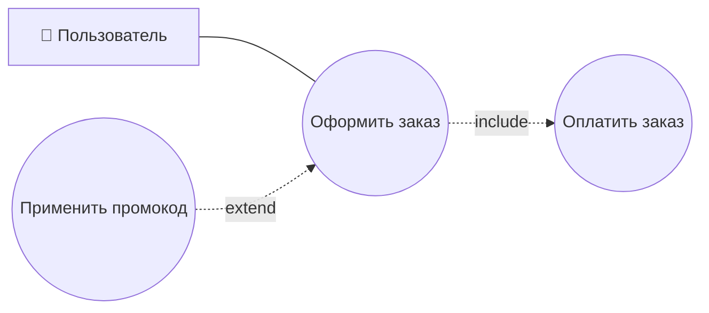

# Вопросы и ответы — подготовка к собеседованию

> Спутник основного файла [Шпаргалка_системного_аналитика.md](Шпаргалка_системного_аналитика.md).
> Здесь собраны практические вопросы собеседований с ответами, по разделам — теория для них разбирается в основном файле.

---

## Вопросы: Требования

<details>
<summary>1. Какие уровни требований есть?</summary>

Три уровня (по Вигерсу):
- **Бизнес-требования** — высокоуровневые цели заказчика/организации, образ и границы проекта;
- **Требования пользователей** — задачи, которые пользователи решают с помощью системы (варианты использования, сценарии, таблицы «событие — отклик»);
- **Функциональные требования** — конкретная функциональность ПО, которую строят разработчики, детализируется в техническом задании.

</details>

<details>
<summary>2. Какие типы требований есть на каждом уровне?</summary>

- **Бизнес-требования** оформляются документом об образе и границах проекта — уставом проекта (project charter) или документом рыночных требований (market requirements document).
- **Требования пользователей** представляются вариантами использования (use cases), сценариями (user journey) и таблицами «событие — отклик»; часто строятся вокруг ключевых ролей (классов пользователей).
- **Функциональные требования** оформляются как спецификация требований к ПО / техническое задание, формулировки — через «должен/должна».

Отдельно, не привязанные к одному конкретному уровню, выделяют ещё три типа требований: **системные требования** (высокоуровневые требования к продукту с несколькими подсистемами), **бизнес-правила** (политики, стандарты, алгоритмы — сами по себе не требования к ПО, но накладывают на них ограничения) и **нефункциональные требования** (атрибуты качества и ограничения).

</details>

<details>
<summary>3. Что такое функциональные и нефункциональные требования? Приведите примеры.</summary>

**Функциональные требования (FR)** определяют, что система должна делать — конкретную функциональность, которую реализуют разработчики, чтобы пользователь мог выполнить свою задачу. Формулируются через «должен/должна».
*Пример:* «Система должна отправлять пользователю письмо с подтверждением заказа после успешной оплаты».

**Нефункциональные требования (NFR)** определяют, какой должна быть система, а не что она делает — атрибуты качества и ограничения: производительность, безопасность, масштабируемость, отказоустойчивость, удобство использования, портируемость, целостность данных.
*Примеры:* «Время отклика страницы каталога не должно превышать 2 секунд при 1000 одновременных пользователей» (производительность); «Передача персональных данных должна выполняться по TLS 1.2+» (безопасность); «Система должна сохранять доступность при отказе одного из серверов кластера» (отказоустойчивость).

</details>

<details>
<summary>4. Какие основные этапы работы с требованиями?</summary>

1. **Сбор информации (выявление)** — интервью с заказчиками, опросы, воркшопы, анализ документов, наблюдение за процессами.
2. **Анализ и моделирование** — структурирование данных, описание бизнес-целей, функциональных и нефункциональных требований, построение диаграмм и схем.
3. **Спецификации** — документирование требований в виде ТЗ, User Story, Use Cases или спецификаций ПО.
4. **Проверка (верификация и валидация)** — контроль полноты, непротиворечивости требований и их соответствия реальным потребностям бизнеса.

</details>

<details>
<summary>5. Какие есть методы сбора требований?</summary>

- Интервью (тет-а-тет с заказчиком или пользователем);
- Совещания и воркшопы (workshops);
- Мозговой штурм (brainstorming);
- Анкетирование и опросы;
- Наблюдение («работа в поле» / observation);
- Изучение документации и аналогов (включая бенчмаркинг конкурентов);
- Прототипирование;
- Event Storming / Use Case (визуальное моделирование процессов и сценариев).

</details>

---

## Вопросы: Интеграции

<details>
<summary>1. Какие стили (технологии) интеграции вы знаете?</summary>

RPC, файловый обмен, общая база данных, REST, SOAP, GraphQL, gRPC, обмен сообщениями через брокеры (RabbitMQ/Kafka), вебхуки и WebSocket.

</details>

<details>
<summary>2. Какие топологии связей (архитектуры интеграции) существуют?</summary>

- **Точка-точка** — прямые связи между системами, просто, но плохо масштабируется («паутина»);
- **Звезда / ESB** — все системы подключены к единой шине-посреднику, которая маршрутизирует и трансформирует данные;
- **Децентрализованная (микросервисная)** — сервисы общаются напрямую по лёгким протоколам (REST, gRPC) или через стриминговые платформы, без единого центра.

</details>

<details>
<summary>3. Какие режимы взаимодействия есть — по направлению и по времени?</summary>

По направлению: **вертикальная** (между уровнями иерархии, например станок — цеховая БД — ERP) и **горизонтальная** (между системами одного уровня, например CRM и почта). По времени: **синхронная** и **асинхронная**.

</details>

<details>
<summary>4. Что такое синхронное и асинхронное взаимодействие? В чём разница, примеры?</summary>

**Синхронное** — отправитель ждёт ответа в реальном времени, прежде чем продолжить работу (пример: REST-запрос проверки остатка товара перед оформлением заказа). **Асинхронное** — отправитель передаёт данные и продолжает работу не дожидаясь обработки, результат приходит позже отдельным сообщением (пример: событие «Заказ создан» в Kafka, которое разные сервисы обрабатывают в своём темпе). Синхронное проще в реализации, но создаёт временную связанность систем (обе должны быть доступны одновременно); асинхронное устойчивее к нагрузкам и сбоям получателя, но сложнее в отслеживании результата.

</details>

<details>
<summary>5. Как сделать асинхронность на синхронном по природе протоколе (например, REST)?</summary>

Сервер сразу отвечает `202 Accepted` с идентификатором задачи, не дожидаясь её завершения. Дальше клиент либо периодически опрашивает статус отдельным GET-запросом (polling), либо сервер сам уведомляет клиента по готовности — через вебхук или WebSocket.

</details>

<details>
<summary>5.1. Что такое асинхронность и когда она применима?</summary>

Асинхронность — модель взаимодействия, при которой отправитель не блокируется в ожидании результата: он передаёт запрос/сообщение и сразу продолжает свою работу, а результат (если нужен) обрабатывается отдельно, когда он будет готов. Применима, когда: результат не нужен немедленно (отправка email, генерация отчёта), нужно устойчиво переживать пиковые нагрузки и временную недоступность получателя, либо один и тот же факт должен обработать не один, а сразу несколько независимых потребителей (событие о заказе — для склада, бухгалтерии и аналитики).

</details>

<details>
<summary>5.2. В чём разница между асинхронными и синхронными запросами? Приведите пример.</summary>

**Синхронный** запрос блокирует вызывающую сторону до получения ответа — пример: сайт при оформлении заказа делает REST-запрос к складу «есть ли товар в наличии?» и ждёт ответа, прежде чем показать пользователю следующий шаг. **Асинхронный** запрос не блокирует — пример: тот же сайт после оплаты публикует событие «Заказ оплачен» в Kafka и сразу показывает пользователю страницу «Спасибо за заказ», не дожидаясь, пока склад, бухгалтерия и служба доставки обработают это событие каждая в своё время.

</details>

<details>
<summary>6. В чём разница между RPC (Remote Procedure Call) и REST?</summary>

RPC — вызов конкретного действия/метода («сделай это», глагол в названии операции, например `createUser`), REST — манипуляция ресурсом через стандартный набор HTTP-методов («сделай что-то с этим объектом», `POST /users`). RPC может работать над любым транспортом, REST обычно строится именно над HTTP и его семантикой (методы, статусы, кеширование).

</details>

<details>
<summary>7. Что такое RESTful и RESTless (REST-like) — опишите подробно каждый.</summary>

**RESTful** — API, полностью соответствующий 6 архитектурным ограничениям REST Филдинга: клиент-сервер, stateless, кешируемость, единообразный интерфейс (в т.ч. HATEOAS — ссылки на связанные действия прямо в ответе), слоистая система, code on demand. **RESTless (REST-like)** — API, который использует HTTP-методы и JSON «в стиле REST», но нарушает часть принципов: смешивает глаголы с ресурсами в URL (`POST /getOrderById`), не реализует HATEOAS, иногда хранит состояние сессии на сервере. На практике абсолютное большинство публичных «REST API» в индустрии — RESTless.

</details>

<details>
<summary>8. Какие типы данных может передавать REST? Может ли он использовать что-то кроме JSON?</summary>

Да — REST как архитектурный стиль не навязывает формат. Помимо JSON встречаются XML, form-data/x-www-form-urlencoded, бинарные форматы (Protobuf, MessagePack), HTML/CSV/PDF/изображения, если ресурс по природе таков, и просто текст. Формат согласуется заголовками `Content-Type` (что передано) и `Accept` (что клиент хочет получить) — это называется content negotiation.

</details>

<details>
<summary>9. Как работает REST?</summary>

Клиент обращается по URL к ресурсу (`/users/123`), действие над ресурсом определяется HTTP-методом (GET/POST/PUT/PATCH/DELETE), сервер возвращает представление состояния ресурса (обычно JSON). Взаимодействие stateless — каждый запрос самодостаточен, сервер не хранит контекст между запросами клиента.

</details>

<details>
<summary>10. Что такое XML, что такое XSD? Может ли XML существовать без XSD?</summary>

**XML** — текстовый формат для описания структурированных данных через вложенные теги, сам по себе не ограничивающий, какие теги допустимы. **XSD** — язык описания схемы XML: какие элементы/атрибуты допустимы, какие у них типы, обязательны они или нет. Да, XML может существовать без XSD — он синтаксически валиден сам по себе (проверяется только правильность синтаксиса); XSD нужен не для того, чтобы XML «работал», а чтобы можно было автоматически проверить его содержимое на соответствие заранее оговорённой структуре.

</details>

<details>
<summary>11. Чем отличается REST от SOAP?</summary>

REST — архитектурный стиль, SOAP — протокол. REST обычно использует JSON и работает только по HTTP; SOAP — только XML и может работать по HTTP, SMTP, TCP. У REST контракт опционален (OpenAPI), у SOAP обязателен (WSDL). SOAP тяжеловеснее, но имеет встроенные стандарты безопасности (WS-Security) — поэтому до сих пор распространён в финтехе и госсистемах, тогда как REST стал стандартом для веб/мобильных API.

</details>

<details>
<summary>12. Что такое SOAP, какова его обязательная структура?</summary>

SOAP — протокол обмена структурированными XML-сообщениями, независимый от транспорта и платформы. Обязательная структура: корневой элемент `Envelope`, внутри — обязательный `Body` (полезная нагрузка запроса/ответа или `Fault` при ошибке) и необязательный `Header` (метаданные — аутентификация, транзакции). Контракт сервиса описывается отдельным XML-документом WSDL.

</details>

<details>
<summary>13. Что такое gRPC, из чего он состоит?</summary>

gRPC — высокопроизводительный RPC-фреймворк от Google на базе HTTP/2 и бинарного формата Protocol Buffers (protobuf). Состоит из: транспорта (HTTP/2 с мультиплексированием), формата сериализации (protobuf) и контракта (`.proto`-файл с описанием сообщений и сервиса), из которого генерируется клиентский и серверный код. Поддерживает 4 типа вызовов: unary, server streaming, client streaming, bidirectional streaming.

</details>

<details>
<summary>14. Приведите пример `.proto`-файла с запросом на создание клиента.</summary>

```protobuf
syntax = "proto3";

message CreateUserRequest {
  string name = 1;
  string email = 2;
}

message CreateUserResponse {
  string id = 1;
  string name = 2;
  string email = 3;
}

service UserService {
  rpc CreateUser (CreateUserRequest) returns (CreateUserResponse);
}
```

</details>

<details>
<summary>15. Что такое ESB (корпоративная шина данных), для чего она нужна?</summary>

ESB — промежуточное ПО, реализующее топологию «звезда»: все системы подключаются не друг к другу, а к единой шине, которая трансформирует протоколы и форматы, маршрутизирует сообщения и может оркестрировать цепочки вызовов в рамках бизнес-процесса. Нужна, чтобы избежать «паутины» прямых связей и централизовать сквозные функции — логирование, безопасность, мониторинг.

</details>

<details>
<summary>16. В чём отличие ESB от брокеров сообщений?</summary>

ESB — «умный» посредник: знает о форматах данных, умеет их трансформировать и оркестрировать бизнес-логику. Брокер сообщений (Kafka/RabbitMQ) — «глупый» транспортный слой («dumb pipes, smart endpoints»): просто надёжно доставляет сообщения, не анализируя их содержимое. ESB часто использует брокер сообщений внутри себя как один из компонентов, но решает более широкую задачу интеграции.

</details>

<details>
<summary>17. Что такое брокер сообщений?</summary>

Программный посредник, через который системы обмениваются сообщениями, не взаимодействуя друг с другом напрямую — он берёт на себя буферизацию, маршрутизацию и гарантии доставки. Основные сущности: producer (издатель) и consumer (потребитель).

</details>

<details>
<summary>18. Какие есть варианты (вариации) работы брокера сообщений?</summary>

Два основных: **прямая отправка через очередь** (point-to-point) — сообщение забирает и обрабатывает ровно один потребитель, после чего оно удаляется; и **публикация/подписка (pub/sub)** — сообщение публикуется в топик/обменник и доставляется копией всем подписанным потребителям.

</details>

<details>
<summary>19. Чем отличается обменник (exchange) в RabbitMQ от топика в Kafka?</summary>

**Exchange в RabbitMQ** — маршрутизатор: продюсер пишет в exchange, а тот раскладывает сообщение по привязанным очередям по правилам (direct/fanout/topic/headers); после того как сообщение забрал и подтвердил (ack) один consumer, оно удаляется. **Топик в Kafka** — не маршрутизатор, а хранилище-журнал (log), разбитый на партиции: сообщение остаётся в топике до истечения срока хранения (retention/TTL) независимо от того, прочитано оно или нет, и его может независимо перечитать любое количество consumer group.

</details>

<details>
<summary>20. В чём различия между Kafka и RabbitMQ?</summary>

RabbitMQ — классический брокер очередей (AMQP) с гибкой маршрутизацией через exchange, сообщение одноразовое и удаляется после обработки; порядок гарантирован в рамках очереди. Kafka — распределённый журнал событий с партициями, сообщения хранятся заданное время (TTL) и могут быть перечитаны множеством потребителей; порядок гарантирован только внутри одной партиции. RabbitMQ лучше подходит для очередей задач (отправка email, обработка платежей), Kafka — для потоковой передачи событий множеству независимых потребителей и event sourcing.

</details>

<details>
<summary>21. Какие методы HTTP вам знакомы?</summary>

GET, HEAD, POST, PUT, DELETE, CONNECT, OPTIONS, TRACE, PATCH.

</details>

<details>
<summary>22. Что такое безопасные методы? Какие методы к ним относятся?</summary>

Метод безопасен, если его выполнение не изменяет состояние ресурса на сервере — только читает данные. К безопасным относятся: `GET`, `HEAD`, `OPTIONS`, `TRACE`.

</details>

<details>
<summary>23. Что такое идемпотентность? Какие методы идемпотентны?</summary>

Идемпотентность — свойство метода, при котором многократное повторение одного и того же запроса приводит систему в то же состояние, что и единичный вызов. Идемпотентны: `GET`, `HEAD`, `OPTIONS`, `TRACE`, `PUT`, `DELETE`. `POST` — не идемпотентен (каждый вызов создаёт новую сущность); `PATCH` по спецификации не обязан быть идемпотентным.

</details>

<details>
<summary>24. Что такое полная и неполная идемпотентность?</summary>

**Полная** — повторные вызовы абсолютно не меняют ни основной ресурс, ни сопутствующие данные. **Неполная (частичная)** — бизнес-значимое состояние ресурса остаётся тем же, но побочные метаданные могут меняться при каждом вызове (например, поле `updatedAt` обновляется на новое время при повторном идентичном `PUT`, хотя сами данные не меняются).

</details>

<details>
<summary>25. Как сделать POST идемпотентным?</summary>

С помощью ключа идемпотентности (Idempotency-Key): клиент передаёт уникальный идентификатор операции в заголовке, сервер запоминает, какие ключи уже обработаны, и при повторном запросе с тем же ключом не выполняет операцию повторно, а возвращает сохранённый результат первого выполнения.

</details>

<details>
<summary>26. Что такое ключ идемпотентности?</summary>

Уникальный идентификатор (обычно UUID), который клиент генерирует для конкретной бизнес-операции (например, одной попытки оплаты) и передаёт в заголовке `Idempotency-Key` при каждой попытке отправки этого запроса — чтобы повторная отправка (например, после таймаута) не создала задвоение результата.

</details>

<details>
<summary>27. Что такое аутентификация и авторизация? В чём разница?</summary>

**Аутентификация** — проверка того, кто перед системой («кто ты?»). **Авторизация** — проверка того, что этому аутентифицированному пользователю разрешено («что тебе можно?»). Аутентификация всегда происходит раньше авторизации.

</details>

<details>
<summary>28. Какие виды авторизации/аутентификации вы знаете? Расскажите о каждой.</summary>

- **Basic Auth** — логин:пароль в Base64 в заголовке `Authorization`, требует HTTPS;
- **Session Auth** — сервер хранит сессию, клиенту выдаёт cookie с её ID (`HttpOnly`);
- **Token-based / Bearer** — клиент предъявляет токен в заголовке `Authorization: Bearer <token>`;
- **JWT** — самодостаточный токен (header.payload.signature) с подписью, позволяет проверять права без обращения к базе;
- **API Key** — статичный идентификатор приложения/клиента для доступа и учёта использования API;
- **OAuth 2.0** — делегированная авторизация («дать доступ к данным без передачи пароля»), выдаёт access/refresh токены;
- **OpenID Connect** — надстройка над OAuth 2.0 именно для аутентификации пользователя (добавляет ID Token);
- **SSO** — концепция единого входа на основе OAuth2/OIDC или SAML.

</details>

<details>
<summary>29. Как формируется подпись (ключ) JWT?</summary>

Header и Payload кодируются в Base64url и объединяются точкой; результат подписывается секретным ключом сервера по алгоритму из заголовка — симметрично (`HS256`, один общий секрет для подписи и проверки) либо асимметрично (`RS256`/`ES256`, подпись закрытым ключом, проверка публичным). Получившаяся подпись добавляется третьим сегментом токена — `header.payload.signature`.

</details>

<details>
<summary>30. Что такое хеширование, и чем оно отличается от кеширования?</summary>

**Хеширование** — одностороннее преобразование данных произвольной длины в строку фиксированной длины (хеш/дайджест) по детерминированному алгоритму (SHA-256 и т.д.); используется для проверки целостности, подписей (в т.ч. в JWT), хранения паролей, быстрого поиска по ключу. **Кеширование** — временное сохранение уже вычисленного или полученного результата, чтобы не пересчитывать/не перезапрашивать его повторно (например, HTTP-кеш по заголовкам `Cache-Control`/`ETag`). Это совершенно разные механизмы с похожими на слух названиями: хеширование — про математическое преобразование данных, кеширование — про производительность и повторное использование результата.

</details>

<details>
<summary>31. Что такое HATEOAS?</summary>

Hypermedia as the Engine of Application State — принцип REST, по которому сервер в самом ответе указывает клиенту ссылки на доступные дальнейшие действия/связанные ресурсы (блок `_links` в ответе), а не требует, чтобы клиент заранее знал все URL из документации. Наличие HATEOAS — главный практический признак «чистого» RESTful API в отличие от RESTless.

</details>

<details>
<summary>32. Чем отличается PUT от PATCH?</summary>

`PUT` заменяет **всё** представление ресурса целиком данными запроса (если не передать какое-то поле — оно будет считаться отсутствующим/сброшенным) и идемпотентен. `PATCH` вносит **частичное** изменение — передаются только те поля, которые нужно изменить, а остальные остаются как есть; идемпотентность `PATCH` не гарантирована спецификацией и зависит от конкретной реализации.

</details>

<details>
<summary>33. Чем отличается Webhook от WebSocket?</summary>

**Webhook** — одностороннее HTTP-уведомление: сторонний сервис сам делает обычный HTTP-запрос на заранее заданный URL, когда происходит событие; соединение не постоянное, создаётся заново на каждое уведомление. **WebSocket** — постоянное двустороннее соединение поверх TCP, которое держится открытым и позволяет обеим сторонам обмениваться данными в любой момент без создания нового соединения.

</details>

<details>
<summary>34. Что такое consumer group и offset в Kafka?</summary>

**Offset** — порядковый номер сообщения внутри конкретной партиции топика (журнал только дописывается, и каждому сообщению присваивается возрастающий номер). **Consumer group** — набор потребителей, которые совместно читают топик, распределяя между собой партиции (внутри группы каждая партиция читается только одним consumer'ом); разные consumer group независимы друг от друга и могут читать один и тот же топик каждая со своей позиции (offset).

</details>

<details>
<summary>35. Почему gRPC обычно не вызывают напрямую из браузера?</summary>

Браузерный JavaScript не имеет низкоуровневого доступа к HTTP/2 фреймам и бинарному протоколу gRPC так, как это нужно для полноценного gRPC-клиента — браузеры не предоставляют нужный API. Поэтому для веб-клиентов используется прослойка **grpc-web** (через прокси-сервер, который переводит упрощённый HTTP/1.1-совместимый вызов в полноценный gRPC) — это одна из причин, почему gRPC остаётся в первую очередь технологией для внутреннего взаимодействия сервисов, а не для публичных веб-API.

</details>

<details>
<summary>36. Что такое OpenAPI/Swagger и для чего он нужен?</summary>

OpenAPI (ранее Swagger) — стандарт описания контракта REST API в виде YAML/JSON-документа: все эндпоинты, методы, параметры, форматы тела, коды ответов и схемы данных. По этому описанию можно автоматически сгенерировать интерактивную документацию (Swagger UI), клиентский код и тесты контракта — то есть для REST это аналог того, что WSDL делает для SOAP и `.proto`-файл для gRPC.

</details>

<details>
<summary>37. Как можно реализовать интеграцию большого файла?</summary>

Через файловый обмен — FTP или SFTP (SFTP предпочтительнее, так как работает поверх SSH и шифрует передачу). Большие файлы обычно не передают через REST/SOAP-запрос напрямую (ограничения на размер тела запроса, таймауты, нагрузка на память) — вместо этого либо кладут файл на FTP/SFTP/объектное хранилище (S3 и аналоги) и передают по API только ссылку/метаданные, либо используют потоковую передачу (chunked upload) с докачкой по частям.

</details>

<details>
<summary>38. Что такое API?</summary>

API (Application Programming Interface) — интерфейс программирования приложений: набор правил и соглашений, по которым одна программа может обращаться к функциям/данным другой программы, не зная деталей её внутренней реализации. REST, SOAP, gRPC, GraphQL — это конкретные архитектурные стили/протоколы, с помощью которых API реализуется поверх сети.

</details>

<details>
<summary>39. Что такое SOAP?</summary>

Протокол обмена структурированными сообщениями на основе XML, независимый от транспорта и платформы, с обязательным контрактом (WSDL) и встроенными стандартами безопасности (WS-Security) — подробный разбор структуры (Envelope/Header/Body/Fault) см. выше, вопросы 11–12.

</details>

---

## Вопросы: Архитектура

<details>
<summary>1. Какие виды архитектуры вам знакомы?</summary>

Монолитная, микросервисная, клиент-серверная, сервис-ориентированная (SOA), бессерверная (serverless), событийно-ориентированная (event-driven), микрофронтенды. Отдельно стоит модульный монолит — гибрид монолита и микросервисов.

</details>

<details>
<summary>2. Плюсы и минусы монолита и микросервисов — в чём разница между ними?</summary>

**Монолит** — всё приложение в одном процессе: просто разрабатывать и деплоить на старте, но сложно масштабировать отдельные части, и ошибка в одном модуле может обрушить всё приложение. **Микросервисы** — набор независимых сервисов со своими БД, общающихся по сети: можно масштабировать и деплоить каждый сервис отдельно, сбой изолирован, можно комбинировать разные технологии — но высокая сложность инфраструктуры, сетевые задержки, сложнее мониторинг и отладка. Главное отличие — в монолите компоненты вызывают друг друга напрямую, в памяти одного процесса; в микросервисах — через сеть (API/события), и у каждого своя зона данных.

</details>

<details>
<summary>3. Когда выгоден монолит, а когда микросервисы?</summary>

Монолит выгоден на старте проекта: MVP, стартап, небольшая команда, когда границы бизнес-доменов ещё не устоялись (её проще быстро переписать целиком, чем при микросервисах). Микросервисы выгодны зрелому продукту с высокой нагрузкой, чёткими границами доменов и несколькими независимыми командами разработки, когда нужно масштабировать и деплоить разные части системы отдельно.

</details>

<details>
<summary>4. Что такое горизонтальное и вертикальное масштабирование, когда они применимы?</summary>

**Вертикальное (scale up)** — увеличение ресурсов одного экземпляра (больше CPU/RAM); просто, но имеет физический предел и обычно требует простоя. **Горизонтальное (scale out)** — добавление дополнительных экземпляров (реплик) с распределением нагрузки между ними через балансировщик; почти не имеет предела и не требует простоя, но сервис должен уметь работать в нескольких копиях (быть stateless или хранить состояние вовне). Горизонтальное — стандартный способ масштабирования микросервисов; вертикальное чаще применяют для монолита или баз данных, где горизонтальное масштабирование сложнее реализовать.

</details>

<details>
<summary>5. Что такое Docker-контейнер?</summary>

Лёгкий изолированный процесс, который упаковывает приложение вместе со всеми его зависимостями в единый переносимый образ и использует ядро хостовой ОС напрямую (в отличие от виртуальной машины, которая эмулирует целое «железо» и гостевую ОС) — поэтому запускается за секунды и весит мегабайты, а не гигабайты.

</details>

<details>
<summary>6. Что такое Pod?</summary>

Минимальная единица развёртывания в Kubernetes: один или несколько контейнеров, которые всегда запускаются, масштабируются и удаляются вместе, разделяя общий IP-адрес и, опционально, общие тома для файлов. Чаще всего — один основной контейнер приложения плюс, при необходимости, вспомогательные sidecar-контейнеры.

</details>

<details>
<summary>7. Что такое режимы оркестрации, какие вам известны?</summary>

Если речь о платформах — Kubernetes (industry-стандарт), Docker Swarm, Nomad. Если речь о стратегиях развёртывания новой версии внутри оркестратора — Rolling Update (постепенная замена экземпляров без простоя), Blue-Green (мгновенное переключение трафика на полностью новую версию рядом со старой), Canary (сначала малая доля трафика на новую версию, потом постепенное увеличение), Recreate (полная остановка старой версии перед запуском новой, с простоем).

</details>

<details>
<summary>8. В чём отличие оркестрации от хореографии?</summary>

**Оркестрация** — централизованная координация: есть выделенный координатор (сервис-оркестратор, workflow-движок или сам Kubernetes для контейнеров), который явно вызывает каждого участника в нужном порядке. **Хореография** — децентрализованная координация: нет центра, каждый сервис публикует и слушает события и сам решает, как реагировать. Оркестрация даёт более прозрачный и управляемый процесс, но делает участников зависимыми от координатора; хореография слабее связывает сервисы, но усложняет отслеживание общего потока выполнения.

</details>

<details>
<summary>9. Для чего нужен API Gateway (AGW)?</summary>

Единая точка входа для внешних клиентов в систему микросервисов: маршрутизирует запросы к нужным сервисам, централизует аутентификацию/авторизацию, может агрегировать ответы нескольких сервисов в один, обеспечивает rate limiting и защиту от перегрузки, а также скрывает от внешнего клиента реальную внутреннюю топологию системы (её можно менять без изменений на стороне клиента).

</details>

<details>
<summary>10. Как общаются между собой микросервисы?</summary>

Синхронно — прямыми вызовами REST/gRPC (вызывающий ждёт ответа); асинхронно — через брокер сообщений (Kafka/RabbitMQ), публикуя и слушая события. На практике это дополняется паттернами Service Discovery (поиск актуального адреса нужного сервиса), Service Mesh (сетевой слой, берущий на себя маршрутизацию/retries/шифрование между сервисами), Circuit Breaker (защита от каскадных сбоев) и Saga (координация распределённых транзакций без общей БД).

</details>

<details>
<summary>11. Назовите основные критерии и характеристики микросервисов.</summary>

Принцип единственной ответственности, независимость развёртывания, автономность и децентрализация данных (своя БД у каждого сервиса), легковесные сетевые коммуникации, независимая масштабируемость, отказоустойчивость (design for failure), свобода выбора технологий, привязка к небольшим кросс-функциональным командам (закон Конвея).

</details>

<details>
<summary>12. Что такое Service Mesh?</summary>

Инфраструктурный слой (например, Istio, Linkerd), который берёт на себя сетевое взаимодействие между микросервисами — маршрутизацию, балансировку нагрузки, повторные попытки, шифрование трафика (mTLS), сбор метрик — обычно через sidecar-прокси рядом с каждым сервисом, так что сами сервисы не реализуют эту логику в своём коде.

</details>

<details>
<summary>13. Что такое паттерн Circuit Breaker?</summary>

Паттерн отказоустойчивости: если вызываемый сервис систематически отвечает ошибкой/таймаутом, «предохранитель» временно перестаёт слать к нему запросы (возвращая быстрый отказ или заглушку), чтобы не каскадировать сбой на вызывающие сервисы, а затем периодически пробует восстановить соединение.

</details>

<details>
<summary>14. Что такое Saga и зачем она нужна в микросервисах?</summary>

Паттерн для распределённых транзакций в микросервисной архитектуре, где классический ACID-transaction на несколько сервисов невозможен (у каждого своя БД). Saga разбивает бизнес-операцию на цепочку локальных транзакций в разных сервисах; при сбое на одном из шагов выполняются компенсирующие действия (откат) по уже выполненным шагам. Бывает оркестрируемой (центральный координатор) и хореографической (через цепочку событий).

</details>

<details>
<summary>15. Что такое Strangler Fig и модульный монолит?</summary>

**Модульный монолит** — монолит с чёткими внутренними границами модулей, спроектированными как будущие кандидаты на отдельные сервисы — промежуточный вариант между монолитом и микросервисами. **Strangler Fig («удушающая лиана»)** — паттерн постепенной миграции монолита в микросервисы: новая функциональность сразу выносится в отдельные сервисы, а старая постепенно «выпиливается» из монолита, пока он не исчезнет совсем — без рискованного единовременного переписывания всей системы.

</details>

---

## Вопросы: Артефакты работы аналитика

<details>
<summary>1. С какими артефактами документов вы работали? Что является артефактами вашей работы? Какие документы использовали?</summary>

BRD, Business Case (ТЭО), User Story, Use Case, User Flow, Screen Map, макеты/прототипы (Mockups), ТЗ, спецификация нефункциональных требований, ER-диаграммы, диаграммы последовательностей (UML Sequence), архитектурные схемы (C4), API-контракты (OpenAPI/WSDL/`.proto`/GraphQL), ПМИ, акты приёмки по итогам ПСИ.

</details>

<details>
<summary>2. Что такое юзер стори?</summary>

Короткое описание функционала с точки зрения пользователя в формате «Как [роль], я хочу [действие], чтобы [цель]», дополненное критериями приёмки (acceptance criteria). Хорошая user story соответствует критериям INVEST: Independent, Negotiable, Valuable, Estimable, Small, Testable.

</details>

<details>
<summary>3. Приведите пример юзер стори.</summary>

«Как зарегистрированный пользователь интернет-магазина, я хочу сохранять товары в список избранного, чтобы быстро найти их позже без повторного поиска».

Критерии приёмки (Gherkin):
```
Given пользователь авторизован и находится на странице товара
When он нажимает кнопку «В избранное»
Then товар добавляется в список избранного пользователя
And кнопка меняет вид на «В избранном»
```

</details>

<details>
<summary>4. Что такое юз-кейс?</summary>

Формализованное описание сценария взаимодействия актёра с системой для достижения конкретной цели — в отличие от короткой user story, явно описывает основной сценарий, альтернативные ветви и исключения/ошибки. Стандартный состав: название, ID, актёры, цель, предусловия, триггер, основной поток, альтернативные потоки, исключительные потоки, постусловия.

</details>

<details>
<summary>5. Опишите пример юз-кейса.</summary>

**UC-01 «Оформить заказ»** · Актёр: зарегистрированный пользователь · Цель: успешно оформить заказ и получить подтверждение · Предусловия: пользователь авторизован, в корзине есть товар.

Основной поток: переход в корзину → система показывает товары и сумму → нажатие «Оформить заказ» → ввод адреса и способа оплаты → подтверждение → система резервирует товары, создаёт заказ, отправляет email.

Альтернативный поток (промокод): на шаге ввода оплаты пользователь вводит промокод → сумма пересчитывается → сценарий продолжается обычным порядком.

Исключительный поток (нет товара): при создании заказа система обнаруживает отсутствие товара на складе → заказ не создаётся → пользователю предлагается убрать товар.

</details>

<details>
<summary>6. Какие потоки есть у юз-кейса?</summary>

- **Основной поток (Main Success Scenario)** — happy path, успешное достижение цели без отклонений;
- **Альтернативные потоки (Alternative Flows)** — отклонения от основного сценария, которые всё равно приводят к успеху (например, другой способ оплаты);
- **Исключительные потоки (Exception Flows)** — ошибки/отказы, не приводящие к цели (например, товара нет в наличии) — по сути, «негативные» сценарии использования.

</details>

<details>
<summary>7. Какие параметры должны быть у хорошего юз-кейса?</summary>

Чётко определённый единственный актёр и измеримая цель; явные предусловия и постусловия; пронумерованный, однозначный основной поток без ветвлений внутри него (ветвления выносятся в альтернативные/исключительные потоки); покрытие как позитивных, так и негативных сценариев; трассируемость к бизнес/пользовательскому требованию, из которого он вырос; достаточная самодостаточность, чтобы его можно было тестировать отдельно.

</details>

<details>
<summary>8. Чем отличается Use Case от User Story? Когда что использовать?</summary>

User Story — короткая, на уровне «кто-что-зачем», без детализации шагов и ошибок; типична для agile/Scrum, где детали дорабатываются в разговоре с командой и в acceptance criteria. Use Case — полный, формализованный сценарий с основным потоком, альтернативами и исключениями; типичен для более формализованных процессов (крупные корпоративные системы, тендерная документация, ГОСТ-проекты), где нужно заранее явно описать все ветвления. На практике: User Story — для быстрой agile-разработки итеративного продукта; Use Case — когда нужна полная, формальная спецификация поведения системы до начала разработки.

</details>

<details>
<summary>9. Какие нотации использовали в работе?</summary>

BPMN и UML (Use Case, Sequence, Class diagram) — для процессов и взаимодействий; ERD — для модели данных; C4 — для архитектуры; Gherkin — для критериев приёмки; OpenAPI/WSDL/`.proto`/GraphQL schema — для контрактов API.

</details>

<details>
<summary>10. Отличие UX от UI.</summary>

**UX (User Experience)** — весь опыт взаимодействия пользователя с продуктом: насколько легко и логично он достигает своей цели (структура, user flow, информационная архитектура, удобство). **UI (User Interface)** — конкретный визуальный слой, через который этот опыт реализуется: кнопки, цвета, типографика, расположение элементов на экране. Можно иметь красивый UI с плохим UX (красиво, но непонятно, как пользоваться) и наоборот.

</details>

<details>
<summary>11. Приходилось ли рисовать макеты?</summary>

Да — от low-fidelity wireframes (Miro/Balsamiq) для быстрой проверки структуры экрана до кликабельных прототипов в Figma для согласования с заказчиком перед передачей в разработку.

</details>

<details>
<summary>12. Приходилось ли рисовать ERD?</summary>

Да — на этапе проектирования данных, обычно совместно с разработчиками/DBA: определяются сущности, атрибуты, первичные/внешние ключи и связи между таблицами, прежде чем писать миграции БД.

</details>

<details>
<summary>13. Как передавали описание запросов разработчикам?</summary>

В виде формальных контрактов API — например, фрагмент OpenAPI для REST-эндпоинта:

```yaml
paths:
  /users/{id}/favorites:
    post:
      summary: Добавить товар в избранное
      parameters:
        - name: id
          in: path
          required: true
          schema: { type: integer }
      requestBody:
        content:
          application/json:
            schema:
              type: object
              properties:
                productId: { type: integer }
      responses:
        '201':
          description: Товар добавлен в избранное
```

Аналогично для SOAP — контракт WSDL/XSD, для gRPC — `.proto`-файл с описанием сервиса и сообщений (см. раздел «Интеграции» — там разобраны все три подробно с примерами).

</details>

<details>
<summary>14. Приведите пример функциональных требований.</summary>

«Система должна позволять зарегистрированному пользователю добавить товар в список избранного и просмотреть список избранных товаров на отдельной странице»; «Система должна отправлять пользователю email с подтверждением заказа после успешной оплаты».

</details>

<details>
<summary>15. Приведите пример нефункциональных требований.</summary>

«Время отклика страницы каталога товаров не должно превышать 2 секунд при 1000 одновременных пользователей»; «Доступность сервиса должна быть не менее 99.9% в месяц»; «Персональные данные пользователей должны передаваться по TLS 1.2 и выше».

</details>

<details>
<summary>16. Как фиксировали требования к сценариям использования? (диаграмма прецедентов)</summary>

Помимо текстового описания use case, сценарии и их связи часто фиксируют визуально — диаграммой прецедентов (UML Use Case Diagram): актёры в виде стикменов, варианты использования в виде овалов, связи `include` (один use case всегда включает другой) и `extend` (один use case опционально расширяет другой при определённом условии).



</details>

<details>
<summary>17. Что такое ERD?</summary>

ERD (Entity-Relationship Diagram, диаграмма «сущность-связь») — графическая модель данных: сущности (будущие таблицы), их атрибуты и связи между ними. Используется на этапе проектирования БД, чтобы согласовать структуру данных с разработчиками до написания миграций/DDL.

</details>

<details>
<summary>18. Какие данные включает в себя ERD-диаграмма?</summary>

- Сущности (таблицы) с понятными названиями, отражающими бизнес-объект;
- Атрибуты каждой сущности — с типом данных, обязательностью (NOT NULL), значениями по умолчанию;
- Первичный ключ (PK);
- Индексы — на атрибутах, по которым часто идёт поиск/фильтрация/джойн;
- Ограничения (constraints) — UNIQUE, CHECK, внешние ключи (FOREIGN KEY) для целостности данных;
- Связи между таблицами — с типом связи и, опционально, поведением при удалении (ON DELETE CASCADE/RESTRICT/SET NULL).

</details>

<details>
<summary>19. Какие типы связей в ERD есть?</summary>

- **Один-к-одному (1:1)** — одна запись таблицы соответствует ровно одной записи другой (например, Пользователь — Паспортные данные);
- **Один-ко-многим (1:N)** — одна запись связана с несколькими записями другой таблицы (например, Клиент — Заказы);
- **Многие-ко-многим (M:N)** — реализуется через промежуточную связующую таблицу с двумя внешними ключами (например, Студенты — Курсы).

</details>

<details>
<summary>20. Чем отличается даталогическая диаграмма от физической?</summary>

**Даталогическая (логическая) модель** — описывает структуру данных независимо от конкретной СУБД: сущности, атрибуты, связи, нормализация — без привязки к специфичным типам данных и синтаксису конкретной базы. **Физическая модель** — конкретная реализация логической модели под определённую СУБД: точные имена таблиц/колонок, конкретные типы данных (`VARCHAR(255)`, `BIGINT` и т.д.), индексы, constraints, партиционирование — то, что реально будет выполнено как DDL-скрипт в базе данных.

</details>

<details>
<summary>21. Что такое ПМИ, приходилось ли писать ПМИ?</summary>

ПМИ (Программа и методика испытаний) — документ, описывающий, что и как будет проверяться перед сдачей системы: объект и цель испытаний, перечень тестовых сценариев со ссылками на требования ТЗ, условия проведения и критерии успешности. Аналитик обычно отвечает за состав тестовых сценариев в ПМИ, так как лучше всех знает исходные требования и use cases, из которых они выводятся.

</details>

<details>
<summary>22. Что такое ПСИ, приходилось ли проходить/писать ПСИ?</summary>

ПСИ (Приёмо-сдаточные испытания) — не документ, а финальный этап: проверка готовой системы перед официальной передачей заказчику по ранее согласованной ПМИ, часто в присутствии приёмной комиссии заказчика. Аналитик готовит тест-кейсы на основе ПМИ, участвует в самих испытаниях (поясняет требования, фиксирует результат «прошёл/не прошёл» по каждому сценарию), а по итогам оформляется Акт приёмки (или Акт о выявленных недостатках при блокирующих замечаниях).

</details>

<details>
<summary>23. Что такое трассируемость требований (requirements traceability) и зачем она нужна?</summary>

Способность проследить цепочку от бизнес-требования через user story/use case, пункт ТЗ, тестовый сценарий в ПМИ и до конкретной подзадачи в трекере разработки — и в обратную сторону. Нужна, чтобы: не потерять требование при декомпозиции на задачи; при изменении требования быстро найти всё, что нужно поменять (код, тесты, документацию); на ПСИ доказать, что каждое требование из ТЗ действительно покрыто тестом и проверено.

</details>

<details>
<summary>24. Чем отличается верификация требований от валидации?</summary>

**Верификация** отвечает на вопрос «правильно ли мы построили систему?» — соответствует ли реализация зафиксированным требованиям (документам, ТЗ). **Валидация** отвечает на вопрос «построили ли мы правильную систему?» — действительно ли она решает реальную потребность пользователя/бизнеса, даже если формально соответствует всем записанным требованиям. Можно пройти верификацию (всё по ТЗ), но провалить валидацию (ТЗ не решало настоящую проблему пользователя).

</details>

<details>
<summary>25. Чем Definition of Done отличается от Acceptance Criteria?</summary>

**Acceptance Criteria** — конкретные условия для ОДНОЙ user story, при которых именно она считается выполненной (своя для каждой истории). **Definition of Done (DoD)** — общий для всей команды/проекта чек-лист качества, применяемый к КАЖДОЙ задаче независимо от её содержания (например: код покрыт тестами, прошёл код-ревью, задеплоен на тестовый стенд, обновлена документация). История может пройти свои acceptance criteria, но не считаться «Done», если не выполнен общий DoD.

</details>

<details>
<summary>26. Что такое BRD (Business Requirements Document) и что он включает в себя?</summary>

BRD — документ бизнес-требований, в котором официально описываются цели, задачи и ожидания бизнеса от создаваемого проекта или продукта: мост между бизнесом и техникой, ответ на вопрос «зачем?», фиксация договорённостей для защиты от разрастания границ проекта (scope creep). Включает: резюме и цели проекта (в формате SMART), описание текущих проблем бизнеса, бизнес-требования, ограничения проекта (бюджет, сроки, ресурсы), анализ затрат и выгод (ROI), ключевых заинтересованных лиц (стейкхолдеров).

</details>

<details>
<summary>27. Что такое ТЭО (технико-экономическое обоснование)?</summary>

ТЭО — документ и комплексный анализ, доказывающий, что реализация проекта/технического решения/инвестиции практически возможна и экономически выгодна. Цели: оценить эффективность инвестиций (окупаемость и сроки), минимизировать риски, обосновать расходы, привлечь финансирование. Компоненты: исходные данные, технические решения, экономический расчёт (срок окупаемости, NPV, IRR, PI), анализ рисков.

</details>

<details>
<summary>28. Чем ТЭО отличается от бизнес-плана?</summary>

ТЭО уже по охвату — сосредоточено на инженерно-технической части и строгом расчёте окупаемости конкретного решения, чаще для модернизации/внедрения продукта на действующем предприятии. Бизнес-план шире — описывает всю стратегию компании: миссию, детальный маркетинг, каналы сбыта, позиционирование на рынке, а не только один проект.

</details>

<details>
<summary>29. Что такое бизнес-план, зачем он нужен и что в него входит?</summary>

Бизнес-план — документ, описывающий стратегию запуска или развития бизнеса/продукта целиком: не «стоит ли делать этот проект» (вопрос ТЭО), а «как бизнес/продукт будет жить и зарабатывать». Нужен, чтобы представить целостное видение команде, инвесторам или банку. Включает: резюме проекта, описание компании/продукта, анализ рынка и конкурентов, организационный план, маркетинговую и сбытовую стратегию, финансовый план, анализ рисков.

</details>

<details>
<summary>30. Что такое нотация Гиркина?</summary>

Формат описания сценариев Given/When/Then («Дано/Когда/Тогда»), используемый в BDD для написания исполняемых спецификаций: читаем бизнесом и одновременно может быть исполнен автоматически как тест (Cucumber, SpecFlow). Чаще всего используется как формат критериев приёмки (acceptance criteria) для user story.

</details>

<details>
<summary>31. Приведите пример бизнес-требования.</summary>

«Сократить среднее время обработки заявки клиента с 3 рабочих дней до 1 дня, чтобы снизить отток клиентов и повысить индекс удовлетворённости (NPS)» — формулируется на уровне бизнес-цели и эффекта для компании, без указания, как именно это будет реализовано технически (в отличие от функционального требования, см. вопрос 14).

</details>

<details>
<summary>32. Приведите пример бизнес-правила.</summary>

«Кредит может быть выдан только клиенту старше 18 лет с подтверждённым источником дохода»; «Скидка постоянного клиента не может превышать 15% от стоимости заказа». Бизнес-правило само по себе не требование к ПО (существует независимо от системы — это политика компании или закон), но накладывает ограничение на то, какие функции и как должна реализовать система.

</details>

<details>
<summary>33. Приведите пример позитивного юз-кейса.</summary>

UC-01 «Оформить заказ» (основной поток, happy path): пользователь переходит в корзину → система показывает товары и сумму → пользователь нажимает «Оформить заказ» → вводит адрес и способ оплаты → подтверждает → система резервирует товары, создаёт заказ и отправляет подтверждение на email. Все условия соблюдены, цель достигнута без отклонений.

</details>

<details>
<summary>34. Приведите пример негативного юз-кейса.</summary>

UC-01a «Неуспешная оплата заказа»: пользователь доходит до подтверждения оплаты, но платёж отклоняется банком (недостаточно средств/ошибка карты) → система не создаёт заказ, сохраняет содержимое корзины и показывает пользователю сообщение с просьбой попробовать другой способ оплаты. Цель актёра не достигнута — это и есть содержание исключительного/негативного сценария.

</details>

<details>
<summary>35. Приведите пример альтернативного потока в юз-кейсе.</summary>

В UC-01 «Оформить заказ», на шаге указания способа доставки: пользователь выбирает не курьерскую доставку, а самовывоз из магазина → система вместо формы адреса показывает список пунктов самовывоза → пользователь выбирает пункт → сценарий продолжается обычным порядком (способ оплаты, подтверждение). Цель в итоге достигается, но другим путём, чем в основном потоке — поэтому это альтернативный, а не исключительный поток.

</details>

---

## Вопросы: Тестирование

<details>
<summary>1. Какие уровни тестирования есть?</summary>

Модульное (unit, полностью изолированное — проверяется один метод/класс), интеграционное (проверка взаимодействия нескольких модулей/сервисов), системное (вся собранная система целиком, в условиях близких к реальным) и приёмочное (проверка заказчиком/пользователями, что система решает реальную задачу). Чем выше уровень — тем меньше изоляция и тем ближе окружение к реальной эксплуатации.

</details>

<details>
<summary>2. Какие типы тестирования вам знакомы?</summary>

По знанию внутренней структуры — чёрный/белый/серый ящик; по проверяемой характеристике — функциональное и нефункциональное (включая нагрузочное); по частоте/назначению — дымовое (smoke) и регрессионное; по исполнению — ручное и автоматизированное.

</details>

<details>
<summary>3. Какие типы проверяемых характеристик есть в тестировании?</summary>

Укрупнённо — функциональные (соответствует ли поведение функциональным требованиям) и нефункциональные (атрибуты качества: производительность, надёжность, безопасность, удобство использования, совместимость, сопровождаемость, портируемость — по модели качества ПО ISO 25010).

</details>

<details>
<summary>4. Чем отличаются чёрный, белый и серый ящик?</summary>

**Чёрный ящик** — тестировщик не знает устройства системы внутри, проверяет только вход/выход через интерфейс относительно требований. **Белый ящик** — тестировщик видит исходный код, проверяет конкретные пути выполнения, ветвления, покрытие кода. **Серый ящик** — промежуточный вариант: частичное знание внутреннего устройства (например, структуры БД или архитектуры), но тестирование по большей части всё равно идёт через внешний интерфейс.

</details>

<details>
<summary>5. Что такое дымовое тестирование и регрессионное тестирование?</summary>

**Дымовое (Smoke)** — быстрая поверхностная проверка самых критичных функций сразу после новой сборки, чтобы понять, стоит ли тестировать дальше. **Регрессионное** — повторная проверка уже работавшей функциональности после изменений в коде, чтобы убедиться, что ничего не сломалось.

</details>

<details>
<summary>6. Какие подходы к тестированию вам знакомы?</summary>

Скриптовое тестирование (по заранее написанным тест-кейсам) и исследовательское (exploratory — без жёсткого скрипта, тестировщик исследует систему по ходу); риск-ориентированное тестирование (приоритет самым рискованным зонам); TDD (Test-Driven Development — тест пишется до кода) и BDD (Behavior-Driven Development — сценарии в формате Given/When/Then, читаемые бизнесом); shift-left testing — вовлечение тестирования как можно раньше в цикл разработки, ещё на этапе требований.

</details>

<details>
<summary>7. Какие артефакты возникают во время тестирования и в конце тестирования?</summary>

Во время: тест-кейсы, чек-листы, баг-репорты. В конце: отчёт о тестировании (test report/summary) с итоговой статистикой и рекомендацией о готовности к релизу, обновлённый набор регрессионных тестов, матрица трассируемости требований к тест-кейсам.

</details>

<details>
<summary>8. Что такое тест-кейс? Приведите пример.</summary>

Пошаговое описание одной проверки: предусловия, шаги, входные данные, ожидаемый результат, фактический результат, статус.

*Пример:*
| Поле | Значение |
|---|---|
| ID | TC-014 |
| Предусловие | Пользователь авторизован, товар «Книга А» в наличии |
| Шаги | 1) Открыть страницу товара 2) Нажать «В избранное» |
| Ожидаемый результат | Товар добавлен в избранное, кнопка меняет вид на «В избранном» |
| Фактический результат | (заполняется при прогоне) |
| Статус | Passed / Failed |

</details>

<details>
<summary>9. Что такое чек-лист?</summary>

Упрощённый список пунктов для проверки без детального описания шагов — быстрее составить, чем полноценный тест-кейс, но менее формализован; используется, когда писать полные тест-кейсы избыточно (например, для быстрой регрессии мелких изменений).

</details>

<details>
<summary>10. Что такое тест-план?</summary>

Документ, описывающий объём, подход, ресурсы и график тестирования: что тестируется и что нет (scope/out of scope), критерии входа и выхода, тестовое окружение, роли участников, риски.

</details>

<details>
<summary>11. Что такое баг?</summary>

Дефект — расхождение между ожидаемым (согласно требованиям/спецификации) и фактическим поведением программы, возникшее из-за ошибки в коде, дизайне или самих требованиях. В строгой терминологии: человеческая ошибка (Error) приводит к дефекту в коде (Defect/Bug), который при выполнении проявляется как наблюдаемый отказ (Failure).

</details>

<details>
<summary>12. Что такое баг-репорт?</summary>

Документ с описанием найденного дефекта: шаги воспроизведения, ожидаемый и фактический результат, окружение (браузер/ОС/версия), степень серьёзности (severity) и приоритет (priority), скриншоты/логи — всё, что нужно разработчику, чтобы воспроизвести и исправить проблему без лишних уточняющих вопросов.

</details>

<details>
<summary>13. Как отличить баг от смежных ситуаций (не-бага)?</summary>

Главный критерий — наличие явного зафиксированного требования/ожидания, которому фактическое поведение не соответствует. Если расхождение есть, но явного требования не было (или оно было описано иначе, а фактический результат просто кому-то не понравился) — это не дефект реализации, а повод уточнить или дополнить требование (change request), а не баг. Также стоит различать баг и запрос на новую функциональность (feature request) — система работает так, как и было задумано, просто задумано было не то, что нужно пользователю сейчас.

</details>

<details>
<summary>14. Что такое отчёт о тестировании?</summary>

Итоговый документ по результатам прогона тестов: сколько тест-кейсов выполнено, сколько прошло/не прошло, какие дефекты остались открытыми (и с какой критичностью), рекомендация команде — готова ли система к релизу/приёмке.

</details>

---

## Вопросы: Иная теория (SOLID, ACID, OSI)

<details>
<summary>1. Назовите принципы SOLID.</summary>

Single Responsibility (единственная ответственность), Open/Closed (открытость для расширения, закрытость для модификации), Liskov Substitution (подстановка подкласса вместо базового класса без изменения поведения), Interface Segregation (узкие интерфейсы вместо одного толстого), Dependency Inversion (зависимость от абстракций, а не от конкретных реализаций).

</details>

<details>
<summary>2. Что такое ACID?</summary>

Четыре свойства надёжной транзакции в реляционной БД: Atomicity (всё или ничего), Consistency (БД остаётся в согласованном состоянии), Isolation (параллельные транзакции не мешают друг другу), Durability (подтверждённые изменения сохраняются даже после сбоя).

</details>

<details>
<summary>3. Чем отличается TCP от UDP?</summary>

TCP — с установлением соединения, гарантирует доставку, порядок и повторную отправку потерянных пакетов, но медленнее (HTTP, email, передача файлов). UDP — без установления соединения, ничего не гарантирует, но быстрее и с минимальными накладными расходами (видео/аудио-стриминг, DNS, онлайн-игры, VoIP).

</details>

<details>
<summary>4. Приведите примеры протоколов прикладного уровня (OSI).</summary>

HTTP, HTTPS, FTP, SMTP, DNS, SSH.

</details>

<details>
<summary>5. Приведите пример протоколов сеансового уровня (OSI).</summary>

RPC, PPTP, L2TP, NetBIOS, SIP — управляют установлением, поддержанием и завершением логической сессии взаимодействия между приложениями.

</details>

<details>
<summary>6. Приведите примеры протоколов транспортного уровня (OSI).</summary>

TCP, UDP, SCTP.

</details>

<details>
<summary>7. Приведите пример протокола сетевого уровня (OSI).</summary>

IP (IPv4/IPv6), а также ICMP, OSPF, BGP.

</details>

---

## Вопросы: BPMN

<details>
<summary>1. Назовите основные элементы BPMN.</summary>

Основные группы элементов нотации:
- Пулы и дорожки (Pools & Lanes) — организация процесса по участникам/ролям;
- События (Events) — стартовые, промежуточные, конечные;
- Действия (Activities) — задачи и подпроцессы;
- Шлюзы / развилки (Gateways) — точки принятия решений и ветвления потока;
- Потоки (Flows) — потоки управления, потоки сообщений, ассоциации;
- Данные (Data) — объекты данных, хранилища данных;
- Артефакты (Artifacts) — группы, аннотации.

</details>

<details>
<summary>2. Назовите основные артефакты BPMN.</summary>

Важно не путать с вопросом выше: в BPMN термин «Артефакты» (Artifacts) — это отдельная, узкая категория элементов, которая не влияет на логику выполнения процесса, а только дополняет диаграмму информацией. Формально в неё входят только:
- Группа объектов (Group);
- Комментарий / текстовая аннотация (Annotation).

Объект данных (Data Object) и хранилище данных (Data Store) — распространённая ошибка их сюда относить: формально это отдельная категория «Данные» (Data), а не «Артефакты», хотя по смыслу (не влияют на логику процесса) они похожи.

</details>

<details>
<summary>3. Что такое пулы в BPMN, какие типы пулов бывают?</summary>

Пул — элемент, представляющий участника процесса целиком (организацию, роль, систему, внешнего партнёра) и выступающий границей/контейнером для всех его операций. Потоки управления не могут выходить за границы пула, а связь между разными пулами показывается только потоками сообщений.

Типы пулов:
- **Развёрнутый** — показывает внутреннее устройство процесса (дорожки, действия, потоки);
- **Свёрнутый** — отображается как пустой прямоугольник («чёрный ящик») без деталей внутреннего процесса;
- **Внешние участники** — как правило, изображаются свёрнутыми пулами, т.к. их внутренний процесс нам не известен или не важен.

</details>

<details>
<summary>4. Что такое дорожки, какие основные свойства дорожек есть, чем они отличаются от пулов?</summary>

Дорожка — подразделение внутри пула, обозначающее конкретного исполнителя операций (роль, подразделение, систему) и используемое для распределения действий процесса между участниками одного пула.

Свойства:
- необязательны к использованию;
- могут быть декомпозированы на дочерние дорожки;
- значимы только для действий — остальные элементы (события, шлюзы, объекты) можно размещать на любой дорожке;
- могут быть вертикальными или горизонтальными (рекомендуется — горизонтально, слева направо);
- название исполнителя может располагаться в любом месте дорожки и в любой ориентации текста.

Отличие от пула: пул — самостоятельный участник процесса и жёсткая граница (потоки управления не выходят за его пределы, связь с другими пулами — только через потоки сообщений). Дорожка — не самостоятельный участник и не граница, а просто способ разделить операции одного участника (пула) между конкретными исполнителями внутри него; потоки управления свободно пересекают дорожки внутри одного пула.

</details>

<details>
<summary>5. Обязательно ли использовать дорожки в BPMN?</summary>

Нет. Дорожки — не обязательный элемент нотации. Если все операции процесса выполняет один исполнитель, дорожки можно не использовать вовсе.

</details>

<details>
<summary>6. Может ли дорожка содержать другие дорожки — приведите пример.</summary>

Да, дорожки можно декомпозировать: любая дорожка может включать дочерние дорожки. Например, дорожка «Организация» может содержать дочерние дорожки «Департаменты», а каждая дорожка «Департамент» — свои дочерние дорожки «Отделы» и так далее.

</details>

<details>
<summary>7. Должна ли дорожка обозначать конкретного исполнителя — сотрудника или подразделение организации?</summary>

Нет, не обязательно. Дорожка в BPMN обозначает исполнителя операций, но нотация не требует, чтобы это был именно конкретный сотрудник или конкретное подразделение — это может быть любая роль, система, механизм или даже абстрактная категория исполнителя, важная в контексте конкретного процесса (например, дорожка «Клиент», «Система CRM» или «Робот»). Главное правило — дорожка должна однозначно обозначать того, кто выполняет расположенные на ней действия; конкретика (должность, отдел, ФИО, система) выбирается аналитиком исходя из того, какой уровень детализации нужен для конкретной диаграммы.

</details>

<details>
<summary>8. Чем отличается процесс от подпроцесса?</summary>

Процесс — это самостоятельная последовательность действий со своим началом и концом (стартовым и конечным событиями), которая в данный момент рассматривается как единое целое и моделируется на отдельной диаграмме (как правило, в своём пуле). Подпроцесс — тот же процесс по сути, но вложенный внутрь другого (родительского) процесса: он используется для декомпозиции сложной задачи на более мелкие шаги. Подпроцесс изображается как действие с маркером «+» и имеет собственную внутреннюю диаграмму, но при этом остаётся частью родительского процесса — делит с ним общий жизненный цикл (запускается и завершается в рамках выполнения родительского процесса).

</details>

<details>
<summary>9. Что такое маркеры задач в BPMN — для чего они нужны?</summary>

Маркер задачи — небольшой графический значок, добавляемый к задаче (обычно в нижней части прямоугольника), который уточняет особенности её выполнения — повторяется ли она, выполняется в нескольких экземплярах или требует отмены (компенсации) ранее сделанных действий. Маркеры нужны, чтобы не вводить для этого отдельные типы элементов: один и тот же маркер можно применить к любому типу задачи (пользовательской, сервисной, скриптовой и т.д.), сохраняя диаграмму компактной и читаемой.

</details>

<details>
<summary>9.1. Какие маркеры задач существуют?</summary>

- **Маркер цикла (Loop marker)** — загнутая стрелка; задача повторяется, пока выполняется (или не исчезает) заданное условие.
- **Многоэкземплярный маркер (Multi-instance marker)** — три параллельные линии (вертикальные — параллельное выполнение, горизонтальные — последовательное); задача выполняется в нескольких экземплярах.
- **Маркер компенсации (Compensation marker)** — два треугольника, повёрнутые влево («перемотка назад»); задача отменяет результат ранее выполненных действий.

</details>

<details>
<summary>9.2. До какого момента выполняется циклический маркер задач?</summary>

До тех пор, пока выполняется (или, в зависимости от формулировки условия, пока не выполнится) условие цикла, заданное для задачи — обычно текстовой аннотацией рядом с ней. Например, задача с циклом «Пока все гости не согласятся» будет повторяться до тех пор, пока это условие не станет истинным (т.е. пока не согласятся все гости) — после чего цикл завершается и процесс идёт дальше.

</details>

